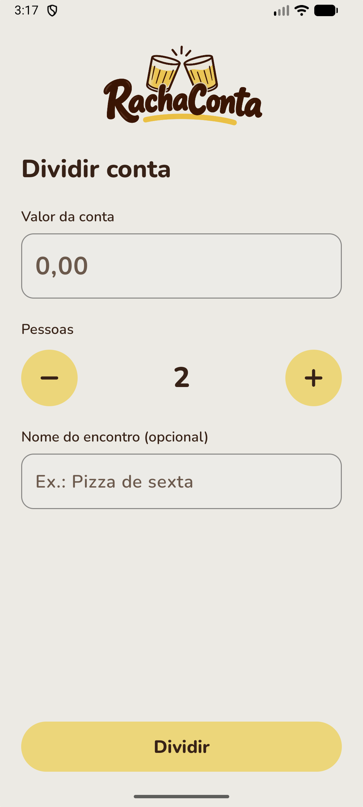
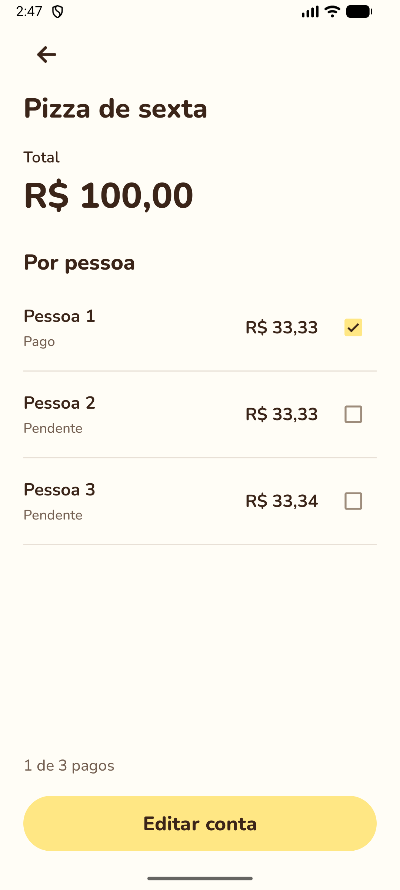

# RachaConta

Aplicativo Android para dividir uma conta igualmente entre amigos e marcar quem já acertou sua parte. Desenvolvido para a **avaliação parcial de Programação Mobile 1 — etapa 1, Android Views/XML**.

## Funcionalidades

- Valor em reais e divisão entre 1 e 50 pessoas.
- Nome opcional do encontro.
- Parcelas calculadas em centavos, com soma exata ao total.
- Checkbox de confirmação à direita de cada pessoa, com Pago/Pendente e contador.
- Edição da conta e preservação de campos/pagamentos durante recriação da tela.
- Funcionamento offline, tema claro/escuro e layout horizontal.

As marcações são manuais e duram durante o fluxo atual; o app não transfere dinheiro nem mantém histórico após encerrar o processo. Uma nova divisão começa com todas as pessoas pendentes. Não há taxa de serviço, API, cadastro ou banco de dados.

## Telas

| Dividir conta | Resultado |
| --- | --- |
|  |  |

O visual de buteco usa amarelo claro, creme, tipografia arredondada e logo com copos americanos. Referência aprovada em [.impeccable/mocks/mesa-v5.png](.impeccable/mocks/mesa-v5.png).

## Como executar

1. Instale Android Studio compatível com Android Gradle Plugin 9.3.1.
2. Clone o repositório e abra **a pasta raiz**, que contém settings.gradle.kts.
3. No SDK Manager, instale **Android SDK Platform 37** e os Build Tools solicitados pelo Gradle.
4. Use **JDK 25** para o Gradle. O projeto inclui critérios do daemon e resolver de toolchains para baixar o JDK quando necessário.
5. Aguarde a sincronização e execute o módulo **app** em um emulador com **Android 13/API 33 ou superior**. A validação foi realizada no Medium_Phone com Android 17/API 37.1.

O Android Studio configura local.properties com o caminho do seu SDK. Esse arquivo é específico da máquina e não é versionado. Nenhum segredo ou arquivo .env é necessário.

No terminal, com JAVA_HOME e ANDROID_HOME configurados:

```sh
./gradlew assembleDebug
./gradlew testDebugUnitTest lintDebug
./gradlew connectedDebugAndroidTest
```

No Windows, use gradlew.bat. O último comando precisa de um emulador iniciado.

APK gerado: app/build/outputs/apk/debug/app-debug.apk. Para instalar:

```sh
adb install -r app/build/outputs/apk/debug/app-debug.apk
```

## Arquitetura

Duas Activities com ViewBinding e navegação por Intent explícita. O código é separado por responsabilidade, mantendo a regra de cálculo independente do Android:

- **ui:** Activities, adapter da lista e tratamento de insets.
- **model:** Conta, ParcelaPessoa e ResultadoRateio, data classes com propriedades val.
- **domain:** cálculo e validação.
- **util:** conversão e formatação de reais.
- **navigation:** contrato da Intent.

Ao marcar um pagamento, copy cria um novo modelo e uma nova lista. savedInstanceState preserva os dados da tela; o RecyclerView reutiliza component_parcela_pessoa.xml com binding e ids estáveis.

Os participantes são simulados: a CalculadoraRateio cria ids de 1 até N, e a interface os apresenta como Pessoa 1, Pessoa 2 etc. O valor da conta e a quantidade são informados pelo usuário; não há cadastro ou consulta externa.

Para R$ 100,00 / 3 pessoas, o resultado é R$ 33,33 + R$ 33,33 + R$ 33,34. O cálculo usa Long em centavos, sem ponto flutuante.

## Bibliotecas e recursos

| Recurso | Uso |
| --- | --- |
| AndroidX Core/Activity/AppCompat | Activities, compatibilidade, eventos e insets das barras/teclado |
| [Material Components](https://github.com/material-components/material-components-android) | Inputs, botões e checkboxes nativos com o tema do app |
| [RecyclerView](https://developer.android.com/jetpack/androidx/releases/recyclerview) | Lista de parcelas com Views recicláveis |
| ViewBinding | Binding gerado pelo Android Gradle Plugin a partir dos XMLs |
| Foojay Toolchain Resolver | Localiza/baixa o JDK necessário ao build quando ele não está instalado |
| JUnit 4 | Testes locais de cálculo, moeda e validação |
| AndroidX Test/Espresso | Testes instrumentados do fluxo no emulador |
| [Nunito](https://github.com/google/fonts/tree/main/ofl/nunito) | Fonte local, com licença SIL OFL em licenses/Nunito-OFL.txt |

AGP 9.3.1 utiliza [Kotlin integrado](https://developer.android.com/build/migrate-to-built-in-kotlin). O projeto não aplica plugin ou dependências de Compose.

Logo e ícone foram produzidos com ImageGen a partir da direção visual aprovada. Prompts e origem estão em [docs/ASSETS.json](docs/ASSETS.json); imagens das telas acima são capturas do app no emulador.

## Requisitos da parcial

| Requisito | Implementação |
| --- | --- |
| Duas telas XML | activity_dividir_conta.xml e activity_resultado.xml |
| Intent explícita com dados | Valor, pessoas e nome opcional enviados para ResultadoActivity |
| Views conectadas ao Kotlin | ViewBinding exclusivo |
| Interação atualizando UI | Seletor de pessoas, checks de pagamento e contador |
| Modelos imutáveis e opcionais | data classes, copy e nomeEncontro: String? |
| Dados simulados | Participantes fictícios locais, exibidos como Pessoa 1 até Pessoa N |
| XML reutilizável opcional | component_parcela_pessoa.xml inflado pelo adapter |

A etapa 2/Compose está fora do escopo. [Enunciado da disciplina](https://github.com/betopompolo/AC322A_MediaTracker/blob/main/docs/Avalia%C3%A7%C3%A3o.md). [MediaTracker de referência](https://github.com/betopompolo/AC322A_MediaTracker).

## Validação e decisões

Evidências e ambiente em [docs/VALIDACAO.md](docs/VALIDACAO.md). Organização e decisões em [docs/ARQUITETURA.md](docs/ARQUITETURA.md). Sistema visual implementado em [DESIGN.md](DESIGN.md).
