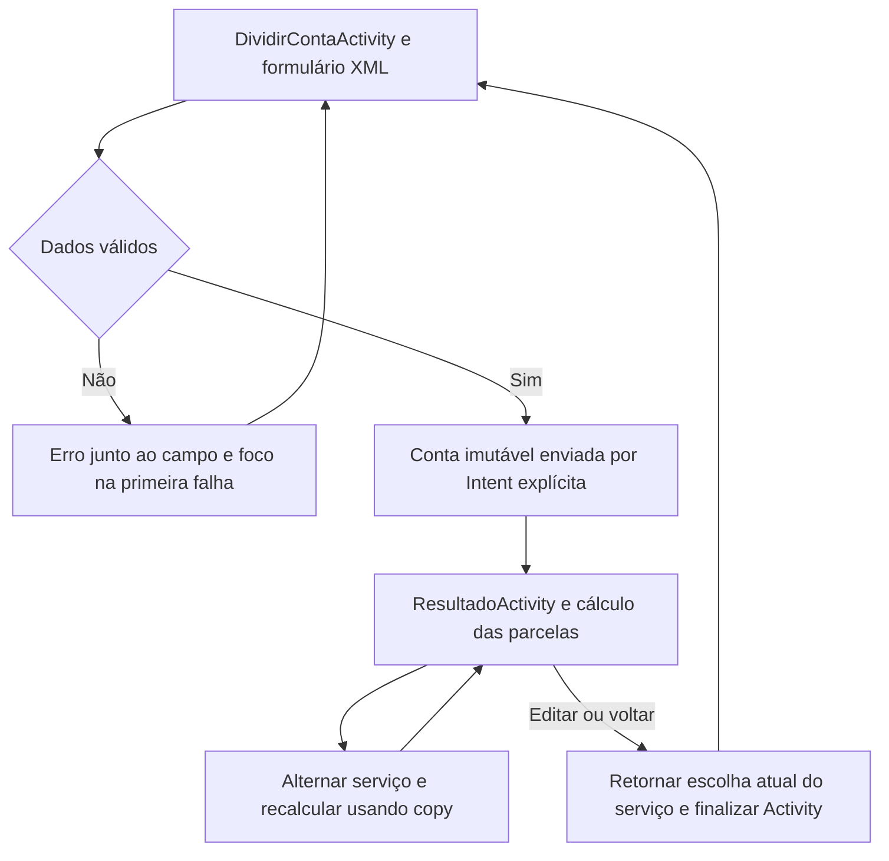

# Planejamento de desenvolvimento e design do RachaConta

> Registro histórico do planejamento inicial. O escopo atual está em `PLANEJAMENTO_ATUAL.md`: serviço removido, acerto por pessoa incluído e identidade em amarelo claro. As decisões conflitantes abaixo foram substituídas.

O RachaConta ajuda pessoas em restaurantes, bares e encontros a dividir uma despesa igualmente, decidir se incluem uma taxa de serviço e conferir valores que fecham a conta até o último centavo. A entrega da parcial terá duas telas Android em XML, Kotlin, ViewBinding e navegação por Intent explícita.

Este plano define o produto, as regras, as telas, as classes, os recursos XML e a sequência de desenvolvimento. O projeto será independente do MediaTracker e desenvolvido em `atividade-parcial-mobile-1`. O MediaTracker permanece como referência das aulas.

## Objetivo e público

O público são grupos de amigos ou colegas que querem dividir uma conta sem refazer cálculos ou discutir diferenças de arredondamento. A tarefa principal deve caber em um fluxo curto: informar a conta, escolher a quantidade de pessoas e conferir quanto pagar.

O app calcula uma divisão e apresenta seu resultado. Não registra pagamentos reais nem movimenta dinheiro.

Critérios de sucesso do produto:

- Uma pessoa consegue calcular uma conta sem conhecer o aplicativo previamente.
- O valor original, o serviço e o total final aparecem de forma compreensível.
- A soma das parcelas é exatamente igual ao total final.
- Voltar para editar preserva os dados preenchidos.
- O fluxo funciona sem conexão e sem cadastro.

## Escopo da parcial

| Funcionalidade | Comportamento definido |
| --- | --- |
| Valor da conta | Entrada em reais, com até duas casas decimais |
| Participantes | Divisão igual entre 1 e 50 pessoas |
| Serviço | Inclusão opcional; percentual inteiro ajustável entre 0% e 30% |
| Identificação | Nome opcional do encontro, com até 40 caracteres |
| Cálculo | Total, serviço e parcelas exatas em centavos |
| Recálculo | Ligar ou desligar o serviço na tela de resultado |
| Edição | Voltar ao formulário mantendo os campos e a escolha atual do serviço |
| Exemplo | Botão que preenche uma conta simulada para demonstrar o fluxo |
| Recriação | Preservar os dados em rotação e recriação com estado salvo |

Os limites de valor, pessoas e percentual são decisões do produto para esta versão. O percentual inicial de 10% é apenas uma sugestão ajustável; o serviço começa desligado e não é incluído sem ação do usuário.

O valor máximo de entrada será R$ 99.999,99. O formulário começa com valor vazio, 2 pessoas, percentual de 10%, serviço desligado e nome vazio.

Divisão por consumo individual, cadastro de participantes, descontos, Pix, histórico, banco de dados, API e compartilhamento ficam para uma evolução futura. Compose, Navigation 3, ViewModel e Repository não fazem parte desta implementação. ViewBinding, AppCompat e componentes Material de Views são adequados à parcial mesmo pertencendo ao ecossistema AndroidX/Jetpack.

## Atendimento ao enunciado

| Requisito da parcial | Evidência no RachaConta |
| --- | --- |
| Duas telas Android Views com XML | `activity_dividir_conta.xml` e `activity_resultado.xml` |
| Intent explícita e passagem de dados | `DividirContaActivity` abre `ResultadoActivity` com valores primitivos e nome opcional |
| Views conectadas ao Kotlin | ViewBinding em todos os layouts |
| Interação que atualiza a interface | Controles de participantes e percentual; recálculo do resultado ao alternar serviço |
| Modelos imutáveis | `Conta` e `ResultadoRateio`, com propriedades `val` |
| Valores opcionais | `nomeEncontro: String?`, com texto padrão quando ausente |
| Dados simulados | `ContasExemplo`, acessível pelo botão `Usar exemplo` |
| ViewBinding exclusivo como item opcional | Sem `findViewById` |
| Componentes XML reutilizáveis como item opcional | Linhas de resumo infladas com binding |
| Entrega executável | Gradle Wrapper, ambiente documentado e validação de clone limpo |

Fragment é opcional no enunciado. Duas Activities atendem diretamente à navegação por Intent e mantêm o fluxo próximo ao conteúdo das aulas.

Fonte: [avaliação da disciplina](https://github.com/betopompolo/AC322A_MediaTracker/blob/main/docs/Avalia%C3%A7%C3%A3o.md), também disponível no projeto de referência em `media-tracker/docs/Avaliação.md`.

## Fluxo de navegação



O formulário permanece na pilha de navegação. Editar usa `finish()` na tela de resultado; não abre outra instância do formulário. Toolbar, botão de edição e botão Voltar do Android devem produzir o mesmo comportamento.

## Direção visual

A interface terá aparência de uma calculadora de mesa: fundo quente, superfícies claras, tipografia legível e destaque em verde escuro para a ação principal e os valores. Os componentes serão Material de Android Views, com um tema próprio e recursos centralizados.

| Token | Tema claro | Tema escuro | Uso |
| --- | --- | --- | --- |
| `colorBackground` | `#F7F5EF` | `#171B18` | Fundo da tela |
| `colorSurface` | `#FFFFFF` | `#232B25` | Campos e cards |
| `colorPrimary` | `#205C3B` | `#A1D8AF` | Botão principal e destaque |
| `colorOnPrimary` | `#FFFFFF` | `#102A1A` | Texto sobre o botão |
| `colorOnSurface` | `#202B23` | `#EDF3EC` | Texto principal |
| `colorOnSurfaceVariant` | `#59645C` | `#B6C3B8` | Texto secundário |
| `colorOutline` | `#77867B` | `#819187` | Contorno de campos |
| `colorError` | `#B3261E` | `#FFB4AB` | Erros com mensagem textual |

Paleta proposta: conferir contraste nas combinações efetivamente utilizadas durante a implementação. O tema escuro seguirá o sistema por `values-night`, mantendo a mesma organização das telas.

Especificação comum:

- Fonte do sistema Android; sem arquivos de fonte externos.
- Título de tela: 24sp; título de seção: 18sp; corpo e campos: 16sp; apoio: 14sp.
- Valores principais: 32sp, com possibilidade de quebra ou adaptação sem cortar números.
- Margem horizontal: 24dp; espaçamentos base: 8dp, 16dp e 24dp.
- Cards com raio de 20dp; campos e botões com raio de 12dp.
- Botão principal com altura mínima de 56dp; controles secundários com área de toque mínima de 48dp.
- Ícones vetoriais pequenos para divisão, pessoas e retorno. Nenhuma imagem externa é necessária.
- Uma ação principal por tela. Erros são indicados por texto e aparência, além de cor.
- Strings e plurais em português brasileiro, separados do Kotlin.

Não haverá menu lateral, barra inferior de navegação, tela de abertura customizada ou autenticação.

## Tela de dividir conta

Objetivo: coletar as informações necessárias e permitir conferir as escolhas antes de calcular.

Ordem do conteúdo:

1. Toolbar com nome `RachaConta`.
2. Título `Vamos dividir a conta?` e apoio `Informe o valor e quantas pessoas vão dividir.`
3. Campo `Valor da conta`, prefixo `R$`, teclado decimal e exemplo `125,50`.
4. Controle `Quantas pessoas?` com botão de diminuir, contador e botão de aumentar.
5. Seção `Serviço opcional`, com switch e apoio `Adicione ao valor informado somente se ainda não estiver incluído.`
6. Controle do percentual: diminuir, valor e aumentar. Desabilitado enquanto serviço estiver desligado.
7. Campo `Nome do encontro (opcional)`, com exemplo `Pizza de sexta`.
8. Botão principal `Calcular divisão`.
9. Botão discreto `Usar exemplo`, que preenche a conta simulada.

O exemplo será `Pizza de sexta`, R$ 100,00, 3 pessoas, percentual de 10%, serviço desligado. Seu objetivo é tornar os mocks visíveis e demonstrar a distribuição de centavos. O botão não abre uma terceira tela.

Estados e feedback:

| Estado | Resposta da interface |
| --- | --- |
| Valor vazio | `Informe o valor da conta.` |
| Valor igual a zero | `Informe um valor maior que zero.` |
| Formato inválido | `Use um valor como 125,50, com até duas casas decimais.` |
| Valor acima do limite | `O valor máximo é R$ 99.999,99.` |
| Nome acima do limite | `Use até 40 caracteres.` |
| Uma pessoa | Botão de diminuir desabilitado |
| Cinquenta pessoas | Botão de aumentar desabilitado |
| Serviço desligado | Percentual preservado, controle desabilitado e taxa aplicada igual a zero |
| Entrada válida | Esconder teclado, abrir resultado uma única vez |

O botão de calcular permanece habilitado para oferecer feedback quando faltarem dados. Validar ao clicar e remover o erro do campo quando ele for corrigido. Evitar mostrar erros antes da primeira tentativa de cálculo.

IDs principais: `toolbar`, `inputValorLayout`, `inputValor`, `buttonDiminuirPessoas`, `textQuantidadePessoas`, `buttonAumentarPessoas`, `switchServico`, `buttonDiminuirPercentual`, `textPercentualServico`, `buttonAumentarPercentual`, `inputNomeLayout`, `inputNome`, `buttonCalcular`, `buttonUsarExemplo`.

## Tela de resultado

Objetivo: mostrar quanto pagar e explicar a composição da conta sem exigir interpretação de números aproximados.

Ordem do conteúdo:

1. Toolbar com retorno e título `Resultado`.
2. Nome do encontro, ou `Sua conta` quando ausente.
3. Card principal com título `Cada pessoa paga` quando todas as parcelas forem iguais.
4. Se houver resto, título `Divisão por pessoa` e dois grupos com valores exatos; por exemplo, `2 pessoas pagam R$ 33,33` e `1 pessoa paga R$ 33,34`.
5. Resumo com valor original, serviço aplicado, total final e quantidade de pessoas.
6. Switch `Incluir serviço de 10%`, exibindo o percentual escolhido no formulário.
7. Quando necessário, apoio `Distribuímos os centavos para fechar o total. A diferença entre parcelas é de no máximo R$ 0,01.`
8. Botão principal `Editar conta`, que retorna ao formulário preenchido.

Quando todas as parcelas forem iguais, mostrar apenas o valor e a quantidade de pessoas. Quando houver resto, não rotular uma parcela arredondada como se fosse o valor exato de todos. Não criar uma lista individual de 50 participantes: dois grupos resumem a divisão.

Ao alternar o serviço, substituir a `Conta` por `conta.copy(incluirServico = ...)`, recalcular e renderizar novamente os valores e linhas. Não duplicar Views já infladas. A escolha atual do serviço será devolvida ao formulário ao voltar.

Se o Intent estiver incompleto ou inválido, mostrar `Não foi possível recuperar esta conta. Volte para informar os dados.` com a ação de retorno. Esse estado é de proteção da navegação, não uma tela adicional.

IDs principais: `toolbar`, `textNomeEncontro`, `cardParcelas`, `textTituloParcelas`, `containerGruposParcelas`, `containerResumo`, `switchServicoResultado`, `textExplicacaoCentavos`, `buttonEditar`, `containerErro`, `textErro`, `buttonVoltarErro`.

## Layouts XML e recursos

As telas usarão `LinearLayout` vertical como raiz, `MaterialToolbar` e `NestedScrollView` com `fillViewport`. O conteúdo rolável será um único `LinearLayout`. Campos e botões participam da rolagem, permitindo uso com teclado aberto e em telas pequenas.

| Recurso | Composição e responsabilidade |
| --- | --- |
| `activity_dividir_conta.xml` | Toolbar, formulário rolável, TextInputLayout/TextInputEditText, controles de quantidade, MaterialSwitch e MaterialButton |
| `activity_resultado.xml` | Toolbar, conteúdo rolável, MaterialCardView, resumo, switch, botão de edição e estado de erro |
| `component_linha_resumo.xml` | LinearLayout com título e valor; reutilizado para conta, serviço, total e pessoas |
| `component_grupo_parcela.xml` | LinearLayout vertical com quantidade de pessoas e valor; inflado uma ou duas vezes |
| `drawable/ic_dividir.xml` | Ícone vetorial decorativo |
| `drawable/ic_pessoas.xml` | Ícone vetorial decorativo |
| `drawable/ic_voltar.xml` | Ícone da toolbar com descrição acessível |
| `values/colors.xml` e `values-night/colors.xml` | Tokens da paleta |
| `values/themes.xml` | Tema `Theme.RachaConta`, baseado em Material3 DayNight de Views |
| `values/styles.xml` | Estilos de campos, botões, cards e textos |
| `values/dimens.xml` | Margens, raios e tamanhos comuns |
| `values/strings.xml` | Textos, mensagens e plurais |
| `mipmap` | Ícone de launcher simples, específico do aplicativo |

Os bindings `ActivityDividirContaBinding`, `ActivityResultadoBinding`, `ComponentLinhaResumoBinding` e `ComponentGrupoParcelaBinding` serão gerados pelo build. Não serão escritos manualmente. [Referência de ViewBinding](https://developer.android.com/topic/libraries/view-binding).

## Arquitetura e responsabilidades

A separação será entre interface, modelos, cálculo, dados de exemplo e conversão. As Activities coordenam eventos e renderização; a regra monetária fica em Kotlin puro e pode ser testada sem Android.

```text
app/src/main/java/com/fragiorgis/rachaconta/
  ui/
    DividirContaActivity.kt
    ResultadoActivity.kt
    NavegacaoConta.kt
  model/
    Conta.kt
    ResultadoRateio.kt
  domain/
    CalculadoraRateio.kt
    ValidadorConta.kt
  data/
    ContasExemplo.kt
  util/
    FormatoDinheiro.kt

app/src/main/res/
  layout/
  drawable/
  mipmap-*/
  values/
  values-night/

app/src/test/java/com/fragiorgis/rachaconta/
  domain/CalculadoraRateioTest.kt
  domain/ValidadorContaTest.kt
  util/FormatoDinheiroTest.kt
```

`com.fragiorgis.rachaconta` será o namespace e applicationId proposto. Classes e propriedades próprias usarão nomes em português consistentes; APIs Android mantêm seus nomes originais.

| Classe ou objeto | Responsabilidade |
| --- | --- |
| `DividirContaActivity` | Inflar binding, manter estado transitório do formulário, tratar cliques, apresentar erros, abrir resultado e receber a escolha atual do serviço |
| `ResultadoActivity` | Ler a conta, restaurar estado, chamar calculadora, renderizar parcelas e resumo, alternar serviço e finalizar com resultado |
| `NavegacaoConta` | Centralizar chaves e conversão de Conta para extras primitivos; validar dados recebidos e devolver resultado de edição |
| `Conta` | Representar entradas válidas, com propriedades imutáveis e limites explícitos |
| `ResultadoRateio` | Representar total, serviço e informações necessárias para os grupos de parcelas |
| `CalculadoraRateio` | Calcular serviço e distribuição de centavos, sem Context ou Views |
| `ValidadorConta` | Validar campos e produzir Conta válida ou erros identificáveis por campo |
| `ContasExemplo` | Disponibilizar uma Conta simulada imutável |
| `FormatoDinheiro` | Converter texto decimal para centavos e formatar centavos em BRL |

`ValidadorConta.kt` pode conter pequenas estruturas auxiliares imutáveis `ValidacaoConta` e `ErrosFormulario`. Os erros devem usar códigos ou enum; as Activities mapeiam esses códigos para `strings.xml`. A validação não depende de recursos Android nem cria mensagens monetárias por concatenação.

Modelos planejados:

```kotlin
data class Conta(
    val valorCentavos: Long,
    val quantidadePessoas: Int,
    val percentualServico: Int,
    val incluirServico: Boolean,
    val nomeEncontro: String? = null
)

data class ResultadoRateio(
    val valorOriginalCentavos: Long,
    val servicoCentavos: Long,
    val totalCentavos: Long,
    val quantidadePessoas: Int,
    val valorBasePorPessoaCentavos: Long,
    val pessoasComCentavoExtra: Int
)
```

`Conta` exigirá valor entre 1 e 9.999.999 centavos, pessoas entre 1 e 50, percentual entre 0 e 30 e nome não vazio de até 40 caracteres quando presente. A entrada em branco vira `null` após `trim()`. A referência da Activity pode mudar, mas cada instância do modelo permanece imutável. Não haverá estado global mutável.

O resultado permite derivar `pessoasComValorBase = quantidadePessoas - pessoasComCentavoExtra` e `valorComCentavoExtra = valorBasePorPessoaCentavos + 1`. Exibir somente grupos com quantidade maior que zero.

Contratos principais previstos:

```kotlin
CalculadoraRateio.calcular(conta: Conta): ResultadoRateio
FormatoDinheiro.lerCentavos(texto: String): Long?
FormatoDinheiro.formatar(centavos: Long): String
ValidadorConta.validar(
    valorTexto: String,
    quantidadePessoas: Int,
    percentualServico: Int,
    incluirServico: Boolean,
    nomeTexto: String
): ValidacaoConta
NavegacaoConta.criarIntent(context: Context, conta: Conta): Intent
NavegacaoConta.lerConta(intent: Intent): Conta?
```

Esses contratos orientam a implementação; não são declarações completas de código. A conversão lê um número decimal bem formado, inclusive zero; o validador aplica os limites de negócio e diferencia erro de formato, valor zero e valor máximo. As Activities mantêm métodos privados para configurar listeners, restaurar estado, ler campos e renderizar conteúdo.

## Regras monetárias

Todos os valores do cálculo usarão `Long` em centavos. Não usar Float ou Double para dinheiro. O valor informado representa a conta antes do acréscimo configurado no app; se já incluir serviço, o usuário mantém o switch desligado.

Conversão de entrada:

- Aceitar `100`, `100,5`, `100,50` e `100.50`.
- Remover somente espaços no início e no fim.
- Aceitar no máximo um separador decimal, vírgula ou ponto, seguido de uma ou duas casas.
- Não aceitar separadores de milhar, símbolos monetários, sinal negativo, letras, notação científica ou casas decimais extras.
- Normalizar vírgula para ponto, converter com BigDecimal, multiplicar por 100 e usar conversão exata para Long; capturar entradas inválidas e valores fora dos limites.
- Formatar saída com Locale `pt-BR` e NumberFormat de moeda, a partir de BigDecimal em escala 2.

Cálculo:

```text
servicoCentavos = incluirServico
    ? (valorCentavos * percentualServico + 50) / 100
    : 0

totalCentavos = valorCentavos + servicoCentavos
valorBasePorPessoaCentavos = totalCentavos / quantidadePessoas
pessoasComCentavoExtra = totalCentavos % quantidadePessoas
```

A taxa é arredondada uma única vez, para o centavo mais próximo, com empate para cima. Os limites definidos mantêm as multiplicações dentro de Long. As primeiras `pessoasComCentavoExtra` parcelas recebem um centavo adicional; a tela apresenta quantidades agrupadas e não escolhe pessoas nominalmente.

Na implementação Kotlin, converter o resto da divisão para Int após o módulo: `(totalCentavos % quantidadePessoas).toInt()`. O valor será sempre menor que a quantidade de pessoas.

| Entrada | Serviço | Resultado esperado |
| --- | --- | --- |
| R$ 120,00, 4 pessoas, desligado | R$ 0,00 | 4 parcelas de R$ 30,00 |
| R$ 100,00, 3 pessoas, desligado | R$ 0,00 | 2 parcelas de R$ 33,33 e 1 de R$ 33,34 |
| R$ 100,00, 3 pessoas, 10% ligado | R$ 10,00 | 1 parcela de R$ 36,66 e 2 de R$ 36,67 |
| R$ 0,05, 1 pessoa, 10% ligado | R$ 0,01 | 1 parcela de R$ 0,06 |
| R$ 0,01, 3 pessoas, desligado | R$ 0,00 | 2 parcelas de R$ 0,00 e 1 de R$ 0,01 |

Invariantes: soma das parcelas igual ao total, nenhuma parcela negativa e diferença máxima de um centavo entre parcelas. Aceitar casos em que o total seja menor que o número de pessoas e mostrar os grupos inclusive de R$ 0,00.

## Intent e preservação de estado

`NavegacaoConta` criará uma Intent explícita apontando para `ResultadoActivity`, com extras `Long`, `Int`, `Boolean` e `String` opcional. Este tamanho de modelo não exige Parcelable, JSON ou Serializable. [Referência de Intents](https://developer.android.com/guide/components/intents-filters).

Verificar presença dos extras obrigatórios antes de aplicar valores e validar os limites ao ler. Não usar valores padrão silenciosos para transformar um Intent incompleto em uma conta aparentemente válida. Não usar `!!` para recuperar o nome.

`DividirContaActivity` usará `ActivityResultContracts.StartActivityForResult` para receber o flag atual de serviço. A navegação continua usando Intent explícita. `ResultadoActivity` atualizará `setResult(RESULT_OK, intentDeRetorno)` sempre que renderizar uma conta válida; assim editar, toolbar e retorno do sistema recebem a mesma escolha.

O Manifest terá apenas `DividirContaActivity` como launcher, `exported=true`. `ResultadoActivity` será `exported=false`. O botão de retorno da segunda Activity finaliza a tela existente.

Salvar em `onSaveInstanceState` os textos do formulário, quantidade de pessoas, percentual, inclusão do serviço e os campos relevantes do resultado. Restaurar estado antes de renderizar e antes de aplicar valores iniciais. Na segunda tela, preferir o estado salvo à Intent original, para não desfazer uma mudança do switch após rotação. A rotação também não deve preencher o mock automaticamente. [Referência do ciclo de vida](https://developer.android.com/guide/components/activities/activity-lifecycle).

O estado salvo serve para recriação da sessão. Reiniciar uma sessão após encerrar o app pode abrir o formulário vazio; histórico permanente não é requisito desta versão.

## Teclado e acessibilidade

- Usar `numberDecimal` no valor e teclado textual no nome, com ações IME adequadas.
- Manter conteúdo e botão alcançáveis por rolagem com o teclado visível; conferir `adjustResize` e insets no Android alvo. [Referência de teclado](https://developer.android.com/develop/ui/views/touch-and-input/keyboard-input/visibility).
- Aplicar insets de barras do sistema sem duplicar padding ou misturar indiscriminadamente `fitsSystemWindows` com tratamento manual.
- Associar labels aos campos; descrições acessíveis para botões de aumentar e diminuir, como `Adicionar uma pessoa`.
- Ícones decorativos não recebem descrições repetindo o texto ao lado.
- Garantir alvos de toque de 48dp, contraste e uso de textos em sp.
- Testar fonte ampliada, tela de 320dp, orientação paisagem e tema escuro.
- Informar erros junto ao campo e mover o foco para a primeira falha.
- Anunciar resultado atualizado com live region ou anúncio acessível, evitando anunciar cada TextView separadamente.
- Usar plurais para `1 pessoa` e `2 pessoas`.

## Base técnica e dependências

O projeto terá um único módulo `app`, Kotlin, Gradle Kotlin DSL e ViewBinding habilitado. A referência usa AGP 9.3.1, Gradle 9.5.0, compile/target SDK 37, min SDK 33, daemon JDK 25 e compatibilidade de código JVM 11. A criação começa reproduzindo a configuração das aulas com dependências apenas de Views e confirmando o sync e o build.

No computador de desenvolvimento, o Android Studio contém JDK 25.0.3, o SDK possui plataforma `android-37.0`, build-tools 36.0.0 e o cache inclui Gradle 9.5.0. O terminal não encontra um JDK registrado via `java_home`; usar o JDK do Android Studio ou configurar JAVA_HOME no processo de build. A disponibilidade dos arquivos não confirma compilação: verificar compatibilidade e eventuais downloads na primeira fase.

Dependências previstas:

| Dependência | Motivo |
| --- | --- |
| AppCompat | Activities e tema de Views |
| AndroidX Core KTX | Extensões e insets |
| AndroidX Activity KTX | Activity Result e integração com ciclo de vida das Activities |
| Material Components | Campos, switches, toolbar, botões e cards XML |
| JUnit | Testes locais de regras monetárias e validação |

Reutilizar as versões das aulas quando compatíveis, fixadas no version catalog, e validar a resolução. Nenhuma dependência de Compose, RecyclerView, ConstraintLayout, rede, banco, coroutines ou injeção de dependência é necessária para o fluxo planejado.

## Sequência de desenvolvimento

| Fase | Trabalho | Critério de conclusão |
| --- | --- | --- |
| 1 Base | Criar projeto independente, namespace, Gradle Wrapper, duas Activities, Manifest e ViewBinding | Sync e assembleDebug passam; app abre no dispositivo |
| 2 Regras | Implementar Conta, ResultadoRateio, validação, formato monetário e calculadora | Testes de centavos, taxa, limites e entrada decimal passam |
| 3 Design XML | Criar tokens, tema, layouts das telas e componentes reutilizáveis | Layouts cabem em tela pequena, com textos grandes e tema escuro |
| 4 Formulário | Conectar campos, controles, validação e exemplo simulado | Erros são claros; dados válidos produzem Conta imutável |
| 5 Fluxo completo | Intent, resultado, recálculo, Activity Result e edição | Parcelas corretas; retorno preserva formulário e escolha do serviço |
| 6 Robustez | Estado salvo, insets, teclado, acessibilidade e dados inválidos | Rotação, navegação e teclado não quebram o fluxo |
| 7 Entrega | README, screenshots, verificação de clone limpo e repositório GitHub | Professor consegue clonar, compilar e executar com as instruções |

Na fase 1, fazer uma compilação mínima antes de desenhar todas as telas. Isso evita descobrir uma incompatibilidade de ambiente somente depois da implementação.

## Plano de validação

Testes locais relevantes:

- Divisão exata e distribuição com resto de 1 ou vários centavos.
- Serviço ligado, desligado, percentual zero e percentual máximo.
- Arredondamento da taxa no meio centavo.
- Valor mínimo, máximo, uma pessoa e limite de participantes.
- Soma das parcelas e diferença máxima de um centavo em várias combinações de valores e pessoas.
- Entrada com vírgula, ponto, uma casa e duas casas decimais.
- Rejeição de vazio, negativo, separador de milhar, casas extras, notação científica e valor fora do limite.
- Nome vazio transformado em null e nome acima de 40 caracteres rejeitado.

Validação manual do fluxo:

1. Abrir o app com os valores iniciais definidos.
2. Usar exemplo e obter R$ 100,00 divididos exatamente entre três pessoas.
3. Ligar serviço no resultado e conferir total de R$ 110,00 e parcelas corretas.
4. Voltar pelo botão de edição, pela toolbar e pelo sistema; conferir campos e switch.
5. Alterar valor e quantidade, calcular novamente e conferir que não há telas duplicadas.
6. Girar nas duas telas, inclusive depois de alterar o serviço.
7. Testar teclado aberto, fonte ampliada, tema escuro e tela pequena.
8. Testar uma Intent incompleta e confirmar retorno seguro.
9. Encerrar e reabrir para confirmar o comportamento de nova sessão.

Comandos de verificação da implementação: `./gradlew testDebugUnitTest`, `./gradlew assembleDebug` e `./gradlew lintDebug`. Depois validar o APK num emulador ou dispositivo compatível com minSdk. Registrar as versões de ambiente efetivamente testadas no README.

## Repositório e entrega

A pasta `atividade-parcial-mobile-1` será a raiz de um novo repositório independente, com nome sugerido `rachaconta-android`. A publicação ocorrerá após a implementação e a verificação do fluxo.

Versionar fontes Kotlin e XML, manifesto, Gradle Wrapper completo, version catalog, README, planejamento e screenshots úteis. Ignorar `local.properties`, caches, builds, configurações locais do IDE e arquivos pessoais. O SDK deve ser localizado pelo Android Studio ou por configuração local não versionada.

O README final deve conter objetivo, público, funcionalidades, screenshots, requisitos de Android Studio/JDK/SDK, instruções de clone e execução, comandos de build e testes, descrição de cada biblioteca externa, estrutura das classes e explicação breve da distribuição de centavos.

Antes de entregar, clonar o novo repositório em uma pasta limpa e confirmar que compila sem editar fontes. A configuração do SDK local faz parte do ambiente documentado. O link desse repositório será entregue no Classroom.

## Definição de pronto

- Duas telas XML funcionais e uma única Activity de entrada.
- Dados corretos transportados por Intent explícita.
- ViewBinding exclusivo e componentes XML reutilizados.
- Mock acessível pelo exemplo, sem API ou banco.
- Modelos imutáveis e nome opcional tratado com segurança.
- Parcelas somam exatamente o total; recálculo atualiza toda a tela.
- Edição, retorno, rotação, teclado e fonte ampliada conferidos.
- Testes de regra, build e lint concluídos, com achados relevantes resolvidos.
- README suficiente para o professor executar o projeto.
- Repositório próprio publicado e link pronto para entrega.
- O aluno consegue explicar modelos, Activities, bindings, Intent, estado salvo, validação e cálculo em centavos.
